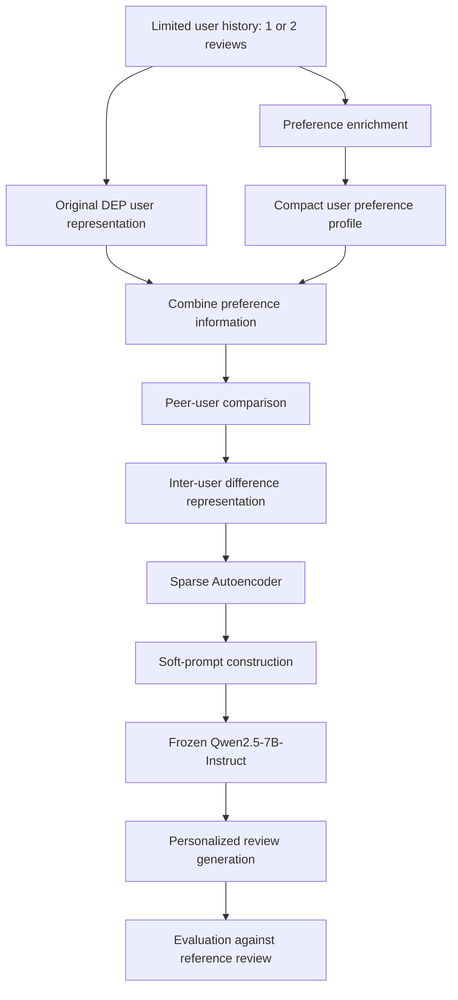

# Improving LLM Personalization under Cold-Start Conditions using Latent Inter-User Difference Modeling

This project investigates how **LLM-based personalization can be improved when a user has very little interaction history**. It extends the Difference-aware Embedding-based Personalization (DEP) framework with a lightweight preference-enrichment stage for users with only one or two previous reviews.

The project evaluates personalized review generation on three Amazon Reviews'23 categories: **Books**, **Movies & TV**, and **CDs & Vinyl**.

## Project at a glance

- **Research area:** Large Language Models, NLP, personalization, representation learning, and cold-start recommendation.
- **Base framework:** Difference-aware Embedding-based Personalization (DEP).
- **Base LLM:** Qwen2.5-7B-Instruct through the released DEP checkpoint.
- **Dataset:** Amazon Reviews'23, using the DEP/DPL-preprocessed data.
- **Cold-start settings evaluated in the final report:** 1 review and 2 reviews, compared with the original full-history setting.
- **Main idea:** Convert the small amount of available review text into an explicit preference signal and provide that signal to the DEP pipeline.

## 1. Motivation and problem statement

Personalized language generation often relies on a user's previous reviews or interactions. When a user has a long history, a model can infer preferences from several examples. A new or low-activity user, however, may have only one or two reviews available. This is known as the **cold-start problem**.

DEP personalizes a frozen LLM by comparing a target user's review representations with those of relevant peer users. It then refines the inter-user difference representation with a Sparse Autoencoder (SAE) and supplies the resulting information to the LLM through soft prompts.

The research question addressed by this project is:

> How can DEP-based personalization be made more informative when a user has only one or two previous reviews?

Rather than replacing DEP, this project adds a preference-enrichment step for sparse-history users and evaluates its effect under controlled history-size conditions.

## 2. Proposed methodology

The modified pipeline uses the limited review history in two ways:

1. The available reviews are passed through the original DEP user-representation pipeline.
2. A preference-enrichment module extracts a compact profile from the same limited reviews.

The enriched preference information is then incorporated into the personalization process. The original DEP peer-user comparison, inter-user difference modeling, SAE, soft-prompt construction, and frozen LLM remain the downstream foundation.

### Workflow



### Preference enrichment

The repository's `enrich.py` implements a **deterministic, rule-based preference extractor**. It operates on the limited reviews and relevant item metadata; it does not require an additional LLM call or a paid API.

The preference profile can contain:

- Genre or theme preferences.
- Liked and disliked aspects, such as plot, characters, acting, music, or pacing.
- Positive or negative sentiment signals, including basic negation handling.
- Rating tendencies.
- A simple description of the user's review-writing style.

The extractor is intentionally lightweight and interpretable. Its results depend on the available vocabulary and rules, so it may miss nuanced language, sarcasm, or preferences that are not explicitly expressed.

### Compared system variants

The code supports three variants:

| Variant | Description |
|---|---|
| `orig` | Original DEP with only the selected most recent reviews available. |
| `enrich_text` | Adds the extracted preference profile to the prompt. |
| `enrich_blend` | Adds the preference profile to the prompt and blends its BGE-M3 embedding into the user representation before peer-user difference modeling. |

For the embedding-blending variant, the implementation uses:

\[
\tilde{e} = \operatorname{Normalize}(e + \alpha p)
\]

where `e` is the original review representation, `p` is the preference-profile embedding, and `α` is the blending weight.

**Result-label note:** The final report labels its modified results as **DEP + enrichment** and does not provide separate numerical result tables for `enrich_text` and `enrich_blend`. The results below therefore retain the report's general label rather than attributing the reported scores to one specific variant.

## 3. Dataset and experimental setup

### Dataset

The experiments use the DEP/DPL-preprocessed **Amazon Reviews'23** dataset in the following categories:

- Books
- Movies & TV
- CDs & Vinyl

The evaluation uses the same users, target items, and test examples across the compared history conditions. For the limited-history settings, the most recent reviews are retained, following the recency-based retrieval setup.

### History conditions

| Condition | Description |
|---|---|
| Full history | Original DEP reference condition. |
| 2 reviews | Only the two most recent reviews are available. |
| 1 review | Only the most recent review is available. |

The code supports additional history-size experiments, including 5 reviews. However, the final report's numerical results include the full-history, 2-review, and 1-review conditions only.

### Model and evaluation

| Component | Description |
|---|---|
| Base framework | DEP (Difference-aware Embedding-based Personalization) |
| Base LLM | Qwen2.5-7B-Instruct, using the released DEP checkpoint |
| Profile embedding model | BAAI/bge-m3 for the embedding-blending variant |
| Personalization mechanism | Peer-user comparison, inter-user difference modeling, SAE, and soft prompts |
| Metrics | ROUGE-1, METEOR, BLEU, and BERTScore-F1 |

The released DEP model is used without fine-tuning its LLM weights as part of this project. The cold-start evaluation is an inference and comparison experiment, not a new five-epoch training run.

## 4. Experimental results

The following values are transcribed from the final project report. The modified system is labelled **DEP + enrichment**, as in that report.

### Main results

| Dataset | Method | History | ROUGE-1 | METEOR | BLEU | BERTScore-F1 |
|---|---|---:|---:|---:|---:|---:|
| Books | Original DEP | Full | 0.3745 | 0.3156 | 13.53 | 0.5557 |
| Books | Original DEP | 1 review | 0.3012 | 0.2312 | 7.03 | 0.5000 |
| Books | DEP + enrichment | 1 review | 0.3300 | 0.2637 | 8.50 | 0.5200 |
| Books | Original DEP | 2 reviews | 0.3307 | 0.2724 | 9.50 | 0.5209 |
| Books | DEP + enrichment | 2 reviews | 0.3515 | 0.2970 | 11.21 | 0.5464 |
| Movies & TV | Original DEP | Full | 0.3092 | 0.2381 | 6.68 | 0.5114 |
| Movies & TV | Original DEP | 1 review | 0.2558 | 0.1816 | 2.81 | 0.4880 |
| Movies & TV | DEP + enrichment | 1 review | 0.2760 | 0.2032 | 3.50 | 0.4950 |
| Movies & TV | Original DEP | 2 reviews | 0.2851 | 0.2100 | 4.89 | 0.5079 |
| Movies & TV | DEP + enrichment | 2 reviews | 0.3000 | 0.2345 | 5.71 | 0.5070 |
| CDs & Vinyl | Original DEP | Full | 0.3165 | 0.2364 | 6.52 | 0.5151 |
| CDs & Vinyl | Original DEP | 1 review | 0.2685 | 0.1898 | 2.91 | 0.4869 |
| CDs & Vinyl | DEP + enrichment | 1 review | 0.2862 | 0.2000 | 3.69 | 0.4950 |
| CDs & Vinyl | Original DEP | 2 reviews | 0.2940 | 0.2101 | 4.81 | 0.5000 |
| CDs & Vinyl | DEP + enrichment | 2 reviews | 0.3100 | 0.2301 | 5.77 | 0.5121 |

### Relative change from adding enrichment

The following percentages compare DEP + enrichment with Original DEP at the same history size.

| Dataset | History | Δ ROUGE-1 | Δ METEOR | Δ BLEU | Δ BERTScore-F1 |
|---|---:|---:|---:|---:|---:|
| Books | 1 review | +9.6% | +14.1% | +20.8% | +4.0% |
| Books | 2 reviews | +6.3% | +9.0% | +18.0% | +4.9% |
| Movies & TV | 1 review | +7.9% | +11.9% | +24.7% | +1.4% |
| Movies & TV | 2 reviews | +5.2% | +11.7% | +16.9% | -0.2% |
| CDs & Vinyl | 1 review | +6.6% | +5.4% | +26.9% | +1.7% |
| CDs & Vinyl | 2 reviews | +5.4% | +9.5% | +19.9% | +2.4% |

### Main observations

- ROUGE-1, METEOR, and BLEU improve in all six reported comparisons across the 1-review and 2-review settings.
- The relative BLEU gains range from **16.9% to 26.9%**.
- ROUGE-1 improvements range from **5.2% to 9.6%**.
- BERTScore changes are smaller. In the Movies & TV 2-review condition, BERTScore-F1 decreases slightly from 0.5079 to 0.5070 (approximately -0.2%).
- Enrichment partially recovers the quality lost when user history is restricted, but it does not consistently reach the full-history reference scores.
- The report estimates that enrichment recovers approximately 37–39% of the 1-review ROUGE-1 gap to full history, and approximately 48%, 62%, and 71% of the 2-review gap for Books, Movies & TV, and CDs & Vinyl respectively.

## 5. Implementation and repository structure

The repository contains the main cold-start extension modules:

| File | Purpose |
|---|---|
| `enrich.py` | Extracts a compact preference profile from limited review history. |
| `build_coldstart.py` | Builds limited-history evaluation sets and the corresponding representations. |
| `eval_coldstart.py` | Runs model inference and calculates evaluation metrics. |
| `make_table.py` | Produces comparison tables from the recorded evaluation results. |
| `show_examples.py` | Displays generated review examples for qualitative comparison. |
| `test_coldstart.py` | Runs sanity checks on the cold-start pipeline using synthetic data. |
| `dep-coldstart.zip` | Packaged copy of the project extension. |

The extension is designed to work with the official DEP repository and its preprocessing, model, and inference components. It is not a standalone chatbot or a standalone LLM implementation.

## 6. Setup and execution

### Prerequisites

- Python 3.11 environment.
- CUDA-enabled PyTorch.
- The official DEP repository and its required data/model files.
- The DEP-compatible vLLM implementation and the dependencies specified by the upstream project.
- A GPU with sufficient memory for the released Qwen2.5-7B DEP model.

### 1. Clone the original DEP repository

```bash
git clone https://github.com/SnowCharmQ/DEP.git
cd DEP
```

### 2. Add this project's extension

Download `dep-coldstart.zip` from this repository and extract it into the root of the official DEP checkout. The archive contains the cold-start package and its test code.

```bash
unzip /path/to/dep-coldstart.zip -d .
```

### 3. Install the upstream environment and prepare data

Follow the installation and data-preparation instructions in the [official DEP repository](https://github.com/SnowCharmQ/DEP). The extension relies on the original DEP/DPL data pipeline, released checkpoint, and compatible inference environment.

### 4. Build limited-history evaluation sets

From the root of the DEP repository, run:

```bash
python -m coldstart.build_coldstart \
  --ks 1 2 5 \
  --variants orig enrich_text enrich_blend \
  --alpha 0.3
```

For a smaller test run, add `--limit 5` or another suitable sample limit.

### 5. Run inference and evaluation

Run inference first, then evaluate the generated reviews. For example:

```bash
python -m coldstart.eval_coldstart \
  --category Books \
  --k 1 \
  --variant enrich_text \
  --mode infer

python -m coldstart.eval_coldstart \
  --category Books \
  --k 1 \
  --variant enrich_text \
  --mode eval
```

Repeat for the required categories, history sizes, and variants. The evaluation script supports `Books`, `Movies_and_TV`, and `CDs_and_Vinyl`, and the variants `orig`, `enrich_text`, and `enrich_blend`.

For the original full-history reference condition, prepare the official DEP test data as described upstream and use `--k full` with `--variant orig`.

### 6. Generate result tables and examples

```bash
python -m coldstart.make_table
python -m coldstart.show_examples --category Books --k 2 --n 5
```

### 7. Run the sanity tests

```bash
PYTHONPATH=. python tests/test_coldstart.py
```

The tests check tensor dimensions and padding, prompt-to-embedding alignment, use of only the permitted recent history, variant differences, prompt-length handling, and preference extraction. These tests validate implementation logic; they are not a substitute for evaluating model quality on the real dataset.

## 7. Reproducibility notes

- Keep the users, target items, reference reviews, and generation settings identical across the compared conditions.
- The evaluation script records the number of evaluated examples in the generated results CSV. Report this sample count when publishing or comparing results.
- Record the exact GPU, inference data type, random seed, temperature, and other generation settings used for each run.
- The evaluation script defaults to `bfloat16`. A GPU used for reproduction must support the selected data type and have sufficient memory. The default settings should not be assumed to run unchanged on every Colab GPU.
- The final report describes one reported run per setting. Multiple seeds, variance estimates, and statistical significance tests were not included.
- The final report does not include separate numerical tables for the `enrich_text` and `enrich_blend` variants. Use the raw evaluation CSV/logs to identify the exact variant behind any result before making a variant-specific claim.

## 8. Limitations

- **Limited statistical validation:** The reported results are from one run per setting. Variance and statistical significance have not been measured.
- **Incomplete history-size reporting:** The final report does not include the planned 5-review results.
- **Preference-extraction constraints:** The rule-based extractor uses limited English lexicons and simple patterns. It may fail to capture sarcasm, subtle context, or preferences not explicitly stated.
- **Embedding-distribution mismatch:** The released DEP SAE was not trained specifically on blended preference-profile embeddings. The `enrich_blend` variant should therefore be interpreted as an experimental modification.
- **Simulated cold start:** Cold-start users are simulated by restricting the history of users who already have longer histories. This may not fully represent genuinely new users.
- **Hardware and software dependency:** Full model inference depends on the original DEP environment, compatible vLLM implementation, released model files, and a suitable GPU.
- **Evaluation metrics:** BLEU and ROUGE measure text overlap, while BERTScore estimates semantic similarity. These automatic metrics do not fully establish whether a generated review faithfully reflects a user's actual preferences; qualitative review analysis and human evaluation would strengthen the study.

## 9. Team and contributions

**M. Pranav Ram (B24DS016)**

- Reproduction of the original DEP pipeline.
- Dataset analysis and construction of controlled limited-history evaluation sets.
- Baseline experiments, metric collection, and baseline-result analysis.

**M.S.V. Sairama (B24DS015)**

- Study of DEP input and profile construction.
- Implementation of the cold-start preference-enrichment module.
- Modified experiments, ablation work, and comparison against the DEP baseline.

**Joint contributions:** Research-paper study, debugging, experimental design, result interpretation, report writing, presentation, and demonstration.

**Affiliation:** B.Tech, Data Science and Artificial Intelligence, Indian Institute of Technology Bhilai.

## 10. Acknowledgements and references

This project builds on the work of the original DEP and DPL authors. Credit for the original personalization framework, dataset pipeline, and released model belongs to their authors.

1. Y. Qiu, T. Shi, X. Zhao, F. Zhu, Y. Zhang, and F. Feng, “Latent Inter-User Difference Modeling for LLM Personalization,” *Proceedings of EMNLP 2025*, pp. 10599–10617.
2. Y. Qiu, X. Zhao, Y. Zhang, Y. Bai, W. Wang, H. Cheng, F. Feng, and T.-S. Chua, “Measuring What Makes You Unique: Difference-Aware User Modeling for Enhancing LLM Personalization,” *Findings of ACL 2025*.
3. Y. Hou et al., “Bridging Language and Items for Retrieval and Recommendation,” 2024. (Amazon Reviews'23 dataset.)
4. A. Salemi, S. Mysore, M. Bendersky, and H. Zamani, “LaMP: When Large Language Models Meet Personalization,” 2023.
5. B. Lester, R. Al-Rfou, and N. Constant, “The Power of Scale for Parameter-Efficient Prompt Tuning,” EMNLP 2021.
6. X. L. Li and P. Liang, “Prefix-Tuning: Optimizing Continuous Prompts for Generation,” ACL 2021.
7. H. Cunningham et al., “Sparse Autoencoders Find Highly Interpretable Features in Language Models,” 2023.

### Upstream resources

- [Official DEP implementation](https://github.com/SnowCharmQ/DEP)
- [DPL repository](https://github.com/SnowCharmQ/DPL)
- [Amazon Reviews'23 dataset](https://amazon-reviews-2023.github.io/)
- [BAAI/bge-m3](https://huggingface.co/BAAI/bge-m3)
- [Qwen2.5-7B-Instruct](https://huggingface.co/Qwen/Qwen2.5-7B-Instruct)

---

**Note:** This repository is intended for academic and research purposes. Check the licenses and usage terms of the upstream DEP/DPL repositories, datasets, and model checkpoints before redistribution or commercial use.
